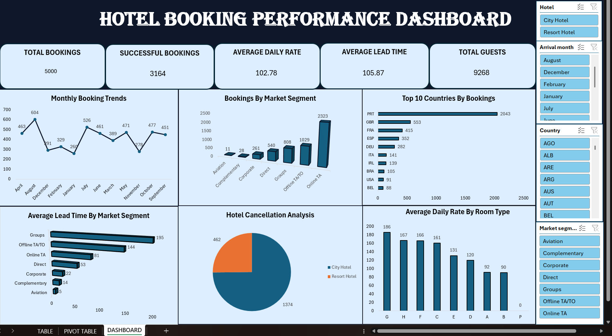

#  Hotel Booking Performance Analysis using Excel

##  Project Overview
This project focuses on analyzing hotel booking data using Microsoft Excel to understand booking patterns, customer behavior, room preferences, and hotel performance. An interactive dashboard was created to summarize key metrics and provide meaningful business insights.

##  Project Objectives
- Analyze hotel booking patterns.
- Understand booking distribution across market segments.
- Compare average daily rates (ADR) by room type.
- Identify the top 10 countries by booking volume.
- Explore booking performance using interactive slicers.

## 🛠️ Tools & Technologies
- **Microsoft Excel:** Data analysis and dashboard creation.
- **Pivot Tables:** Data summarization and aggregation.
- **Pivot Charts:** Data visualization.
- **Slicers:** Interactive filtering.
- **Data Cleaning:** Handling missing values and preparing data.

##  Dataset Used
The project uses a hotel booking dataset containing information about hotel reservations, room types, market segments, countries, and average daily rates.

A sample of 5,000 records was selected from a larger dataset containing over 100,000 records.

##  Key Analysis
- Average Daily Rate (ADR) by room type.
- Average lead time by market segment.
- Top 10 countries by number of bookings.
- Booking distribution across different categories.
- Interactive analysis using slicers.

##  Key Insights
- Compared average daily rates across room types.
- Identified countries contributing the highest booking volumes.
- Examined differences in booking lead time across market segments.
- Used interactive filters to explore booking performance.

## 📊 Dashboard Preview

##  Conclusion
This project demonstrates the use of Excel for data cleaning, exploratory analysis, Pivot Tables, Pivot Charts, and interactive dashboard development. It highlights practical skills in transforming booking data into meaningful visual insights.

##  Author
Aswathi A

